

**Русский** · [English](#eng)

# Сход-развал — инструкция

Сход-развал — это не магия и не секрет мастерских. Это четыре колеса, несколько углов и порядок, в котором их выставлять. Здесь — всё, что нужно, чтобы сделать это самому и правильно: от установки программы до протокола.

Та же инструкция есть в программе — клавиша **F1**. Подробности о методе и точности — в [PROCEDURE.md](PROCEDURE.md).

**Содержание:** [Коротко: пять шагов](#ru-start) · [Установка и первый запуск](#ru-install) · [Настройки и доступность](#ru-access) · [Углы простыми словами](#ru-angles) · [Шаг 1. Автомобиль](#ru-vehicle) · [Шаг 2. Подготовка](#ru-prep) · [Инструмент и площадка](#ru-tools) · [Замер: струна и угломер](#ru-string) · [Замер: телефон на колесе](#ru-phone) · [Замер: камера и мишени](#ru-optical) · [Замер: свой датчик](#ru-sensor) · [Шаг 4. Экран регулировки](#ru-live) · [Порядок регулировки — не переставляйте](#ru-order) · [Шаг 5. Отчёт](#ru-report) · [Износ шин подскажет](#ru-tyres) · [Диагностика: что погнуто](#ru-diag) · [Контрольная поездка](#ru-road) · [Типы подвески](#ru-susp) · [Грузовики, автобусы, фургоны](#ru-trucks) · [Когда регулировка не поможет](#ru-bent) · [Откуда берутся допуски](#ru-data) · [Если что-то не работает](#ru-trouble) · [Откуда методика](#ru-sources) · [Безопасность](#ru-safety) · [Клавиши](#ru-keys)

## Коротко: пять шагов

1. **Автомобиль.** Найдите машину в базе или возьмите ориентир по классу. Проверьте тип передней и задней подвески — от него зависят проверки и советы по регулировке.
2. **Подготовка.** Чек-лист под вашу подвеску: давление, люфты, загрузка, площадка. Изношенную подвеску регулировать бесполезно — углы «уплывут» при первой же кочке.
3. **Замер.** Выберите, чем мерить: струна и угломер, телефон, камера или свой датчик. Способы можно сочетать — например, развал и кастер телефоном, схождение струной.
4. **Регулировка.** Экран как у стенда: крупные цифры, зелёные — в допуске, красные — нет; над каждой — шкала допуска со стрелкой. Нажмите на угол — справа появится, чем он регулируется на вашей машине. Перед первым поворотом ключа сделайте снимок «до» (F5).
5. **Отчёт.** Когда всё зелёное — снимок «после» (F5) и протокол с таблицей «до / после» (F6). Его можно распечатать или сохранить в PDF.

**Не потеряется ничего.** Выбранная машина, введённые числа, снимки «до» и «после», отметки подготовки и госномер хранятся программой: закрыли её, открыли завтра — всё на месте, экран откроется там, где вы остановились. Следующую машину начинайте кнопкой **«Новый автомобиль»** в меню слева (или в протоколе): всё прежнее очистится, а калибровки телефонов и камер останутся.

**Подсказка «что дальше»** на экране регулировки ведёт по всей работе: снимок «до», затем углы в правильном порядке, снимок «после», протокол. Кнопка в этой строке сразу делает нужное.

> Новичку: запустите демонстрацию (F9 на экране регулировки) и нажмите F10 — программа сама покажет, в каком порядке и как выставляются углы. Стрелками ← → можно «покрутить» любой угол самому и посмотреть, что при этом происходит с соседними.

## Установка и первый запуск

1. **Скачайте** `wheelalign.exe` со страницы релизов проекта на GitHub. Установка не нужна: это один файл, его можно держать хоть на флешке.
2. **Запустите.** Откроется окно программы. Оно работает на движке WebView2, который встроен в Windows 10 и 11. Если окно не появилось, программа откроется в обычном браузере и подскажет, что установить.
3. **Язык** — переключатель RU / EN в правом верхнем углу. При первом запуске выбирается язык системы; ваш выбор запоминается.
4. **Интернет не нужен.** Всё работает на этом компьютере. Сеть нужна только телефону-датчику, и то локальная (Wi-Fi), а не интернет.

Где лежат ваши данные: `%APPDATA%\wheelalign` (в Linux — `~/.config/wheelalign`). Там настройки (`settings.json`), текущая работа — машина на стенде, введённые числа, снимки (`session.json`), ваши допуски (папка `vehicles`), калибровки телефонов (`phones.json`) и доступ для них (`phone-link.json`), сертификат для телефона (`tls`) и журнал работы `wheelalign.log` — его стоит приложить к сообщению об ошибке.

Ключи запуска: `-browser` — открыть в браузере вместо окна; `-data <папка>` — хранить данные в другом месте (например, рядом с программой на флешке). Полный список — `wheelalign -h`.

## Настройки и доступность

Программа должна быть удобна каждому: тому, кто работает в ярком гараже, кто плохо видит или не различает цвета, кто лежит под машиной один или пользуется только клавиатурой. Всё это — в «Настройках» (значок ⚙ вверху справа): применяется сразу и хранится в файле настроек программы.

- **Тема.** Тёмная — как экран стенда; светлая — для яркого гаража и солнца; высокий контраст — чёрное и белое, яркие цвета и толстые рамки.
- **Размер интерфейса** — обычный, крупный, очень крупный: увеличивается всё сразу — текст, кнопки, цифры.
- **Цвета состояний.** Если красный и зелёный трудно различить, включите «Синий и оранжевый». Рядом с цветом всегда стоит знак: **✓** — в допуске, **!** — у границы, **✕** — вне допуска; знаки видны и на чёрно-белой распечатке протокола.
- **Без анимации** — для тех, кому мешает мигание. По умолчанию программа следует настройке Windows «Показывать анимацию».
- **Регулировка на слух.** Выберите угол на экране регулировки и включите звук (<kbd>F7</kbd>): вне допуска программа пищит — тем чаще, чем ближе к допуску, — при входе в допуск звучит перезвон, при выходе — низкий тон. Голос (<kbd>F8</kbd>) читает выбранный угол вслух, говорит, когда он вошёл в допуск и когда в допуске всё. Голос — системный, Windows; если для вашего языка его нет: Параметры → Время и язык → Речь → «Добавить голоса».
- **Без мыши.** Всё доступно с клавиатуры: <kbd>Tab</kbd> — к следующему элементу, <kbd>Enter</kbd> или пробел — нажать, <kbd>Esc</kbd> — закрыть панель; F-клавиши подписаны внизу экрана. Рамка показывает, где фокус. Экранный диктор (встроенный в Windows или NVDA) читает показания, итог и сообщения программы.
- **Мастерская.** Название, адрес и исполнитель попадают в шапку протокола.
- **Приветствие** при первом запуске проводит по этим настройкам и помогает выбрать способ замера. Открыть его снова — «Настройки → Показать приветствие снова».

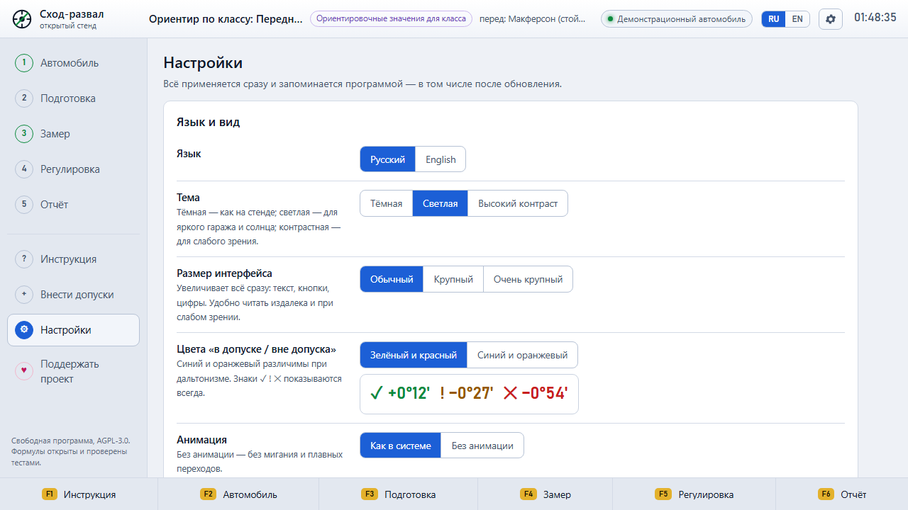

## Углы простыми словами

| Угол | Что это | Если не в норме |
|---|---|---|
| **Развал** | Наклон колеса поперёк машины, если смотреть спереди. «Плюс» — верх колеса наружу. | Изнашивается одна сторона протектора (внешняя при «плюсе», внутренняя при «минусе»). Разница развала слева и справа больше ~0,5° — машину тянет в сторону большего развала. |
| **Схождение** | Поворот колеса в плане, если смотреть сверху. «Плюс» — передний край колеса ближе к оси машины (колёса «сходятся»). | Самый «дорогой» угол: резина стирается «пилой» за несколько тысяч километров. Кривой руль при прямом ходе — схождение колёс разделено неправильно. |
| **Кастер** | Продольный наклон оси поворота (у «шкворневых» машин — шкворня). «Плюс» — верх оси назад. | Руль плохо возвращается, машина «рыщет» на скорости. Разница слева и справа — увод в сторону меньшего кастера. |
| **Поперечный наклон оси (SAI)** | Наклон оси поворота поперёк машины. Задан конструкцией. | Не регулируется. Разница между бортами — признак погнутой стойки, кулака или балки. |
| **Включённый угол** | SAI + развал. | Разный слева и справа больше чем на 1° — деталь погнута; регулировкой развала это не лечится. |
| **Угол тяги** | Куда направлена задняя ось относительно оси симметрии машины: половина разности схождения задних колёс. | Машина едет «боком», руль при прямом ходе стоит криво, хотя переднее схождение в норме. |

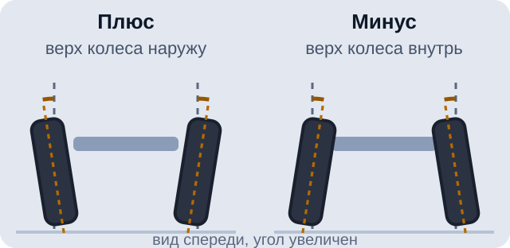 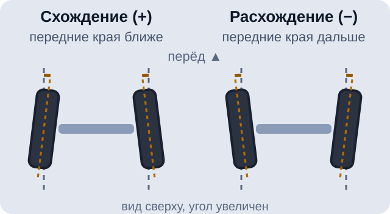 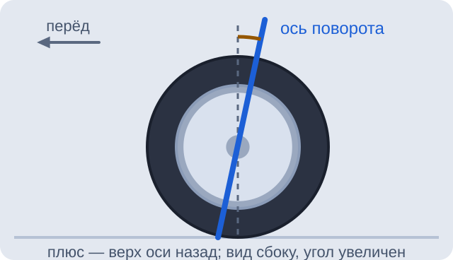

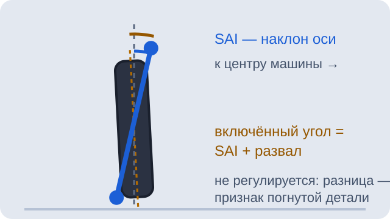 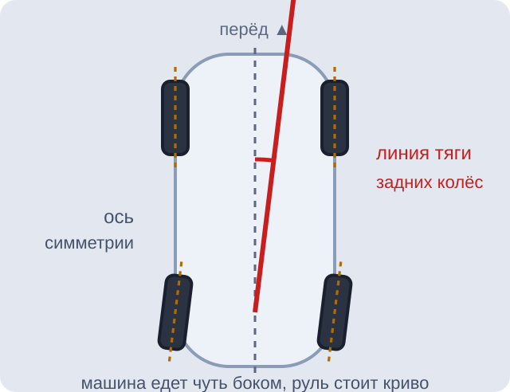

Коротко о том, что уводит машину (бюллетень Hyundai 20-SS-001H): её тянет к колесу с большим положительным развалом — разница развала передних колёс должна быть меньше 0,5°, — и к колесу с меньшим кастером. Схождение на увод не влияет, но от него зависят износ шин и то, ровно ли стоит руль. Увести машину могут и шины (разное давление, «кривой» корд), подтормаживающий тормоз, просевшая пружина, уклон дороги и боковой ветер.

## Шаг 1. Автомобиль

- **Поиск** — по марке и модели, по-русски или латиницей: «Волга 3110», «ГАЗель», «2107», «Hilux». Фильтры сверху сужают список до легковых, внедорожников, фургонов, грузовых или автобусов; поле «Год» отсекает другие поколения.
- **Не знаете, как пишется?** Пока поле поиска пустое, ниже — все марки по регионам (СССР и Россия, Европа, США, Азия) с числом моделей и недавно выбранные машины. Нажмите на марку — останутся только её модели.
- У каждой записи есть **метка источника**: заводское руководство, сообщество, «не проверено», «только конструкция». Чем метка слабее, тем внимательнее относитесь к цифрам — подробно в разделе «Откуда берутся допуски».
- **Модели нет в базе?** Выберите ориентир по классу («легковой с McPherson», «грузовик с балкой на шкворнях»…). Это типичные значения для конструкции, а не для вашей модели: программа покажет, насколько углы далеки от типичных, и будет честно предупреждать об этом на всех экранах.
- **Подвеска.** Программа подставляет тип подвески из базы; если его нет — выберите сами. Кнопка «Как узнать, какая у меня?» подскажет, по каким признакам отличить шкворень от шаровой опоры, McPherson от двух рычагов.
- **Размеры.** Диаметр обода нужен, чтобы перевести схождение из градусов в миллиметры (так пишут во многих руководствах). Колея передней и задней оси — для проверки установки струн.
- **Свои допуски.** Если у вас есть руководство по ремонту — кнопка «Внести допуски из руководства». Программа проверит цифры на опечатки и будет пользоваться ими на этом компьютере.

Можно работать и без выбора автомобиля — тогда углы показываются без оценки «в норме / не в норме».

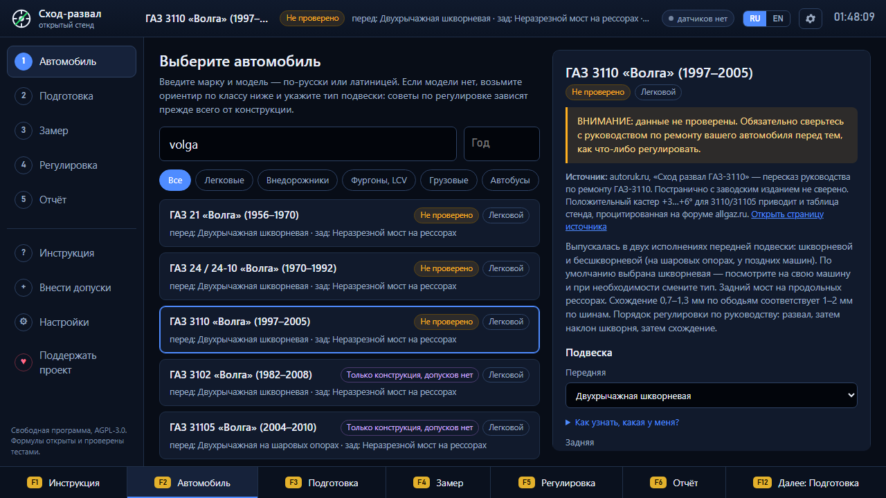

## Шаг 2. Подготовка

У пунктов с рисунком есть кнопка **«Как это выглядит»** — схема откроется прямо под пунктом.

Чек-лист собран под выбранную подвеску: для шкворневой балки — люфт шкворней, для McPherson — опорные подшипники стоек, для рессор — стремянки и центральный болт. Пункты разбиты на группы — безопасность, инструмент, площадка, автомобиль, передняя и задняя подвеска; у каждой свой счётчик. Крупно — что сделать, мелко — почему. Отмечайте пункты по мере проверки — отметки сохраняются; когда отмечено всё, появится «Всё готово — можно мерить».

Группа «Инструмент» зависит от способа замера: для струны — леска и угломер, для телефона — планка и общая сеть Wi-Fi, для камеры — мишени и штатив. Способ можно выбрать прямо в этой группе — на шаге «Замер» он уже будет выбран.

- **Давление в шинах** — по табличке на стойке двери, на холодных шинах. Разница 0,3 бар между бортами уже меняет развал.
- **Люфты** — рулевые наконечники, шаровые опоры или шкворни, подшипники ступиц, сайлентблоки. Если колесо качается рукой — сначала ремонт.
- **Загрузка** — как требует руководство: обычно полный бак, запаска и инструмент на месте, в салоне никого. У грузовиков и автобусов — указанная нагрузка на ось.
- **Руль прямо.** Перед замером схождения поставьте руль ровно и зафиксируйте (упор между рулём и сиденьем).
- **Подвеска «осела».** После подъёма машины покачайте кузов и прокатите её на 3–5 метров вперёд — рычаги встанут в рабочее положение. Назад не катите и вбок не толкайте: сайлентблоки останутся поджатыми не так, как при езде.

## Инструмент и площадка

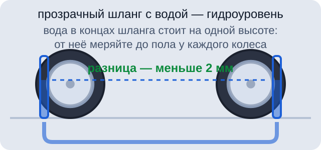 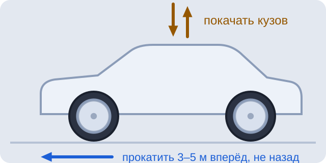 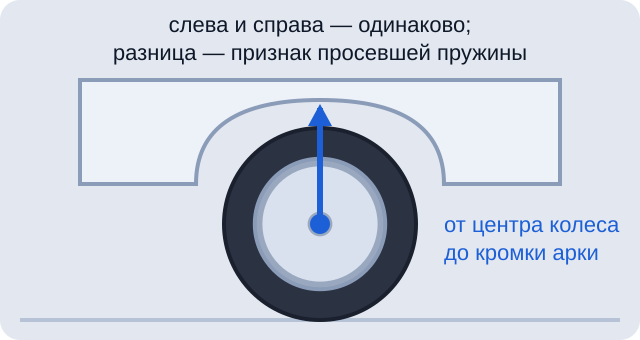

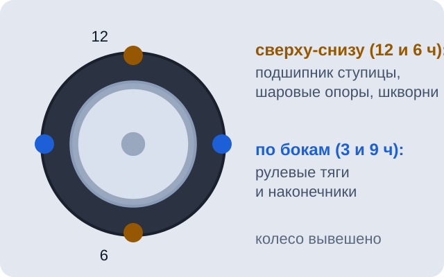 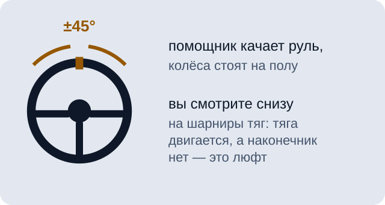

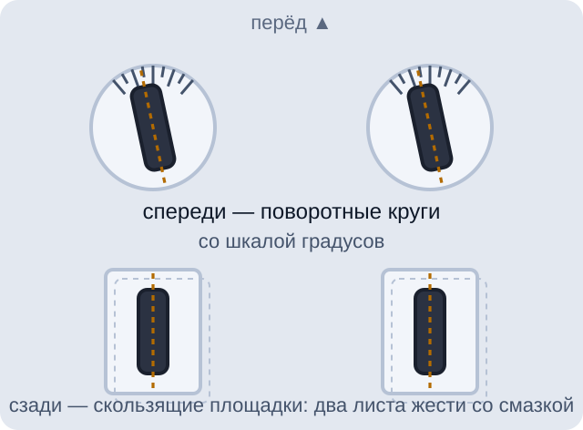 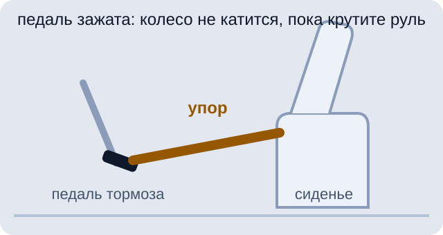 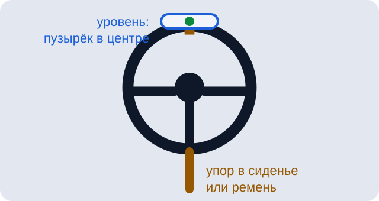

| Что | Зачем | Чем заменить |
|---|---|---|
| Леска 0,3–0,5 мм, 2 × 5 м | Опорные линии для схождения | Только не нитка — провисает и тянется |
| 4 стойки до высоты ступиц | Держат струны | Кирпичи с брусками, вёдра с песком |
| Грузы по 2–4 кг | Натягивают струны без провисания | Бутыли с водой |
| Рулетка, штангенциркуль или линейка | Отступы до обода | — |
| Угломер или смартфон | Развал | Пузырьковый уровень с транспортиром |
| Ровная планка 40–50 см | Прикладывать угломер или телефон к закраинам обода | Алюминиевое правило |
| Поворотные круги | Кастер | Два листа жести со смазкой между ними |
| Подставки под машину | Безопасность | **Не заменять домкратом. Никогда.** |

**Площадка важнее всего.** Нужна не «горизонтальная», а *плоская*: все четыре колеса в одной плоскости. Ямка 5 мм под одним колесом при колее 1400 мм — это 0,2° ошибки развала, половина заводского допуска. Проверьте гидроуровнем (прозрачный шланг с водой): разница между пятнами контакта — меньше 2 мм. Подкладывайте стальные пластины, не деревяшки. Поворотные круги и подкладки под задние колёса должны быть одной высоты.

## Замер: струна и угломер

1. **Струны** — вдоль бортов, снаружи колёс, на высоте центра ступиц, натянуты грузом. Отступ от струны до центра ступицы спереди и сзади **не обязан быть одинаковым**: при разной колее передней и задней оси разница должна быть (колея зад − колея перед) / 2. Введите четыре отступа в «Проверку установки струн» — программа скажет, какой конец и на сколько сдвинуть.
2. **Развал** — угломер на планку, прижатую к закраинам обода (не к резине). «Плюс» — верх колеса наружу. Если ваш угломер показывает наоборот, отметьте это галочкой. Затем прокатите машину на пол-оборота колеса (метка мелом на шине) и приложите угломер к тому же месту обода. Программа усреднит два числа и уберёт биение диска; биение больше 0,5° — диск погнут, замеры этого колеса ненадёжны.
3. **Схождение** — от струны до закраины обода спереди и сзади колеса, строго на высоте ступицы. Выше или ниже — в замер подмешивается развал. Колесо смотрит внутрь — переднее расстояние больше; так и вводите.
4. **Кастер** — на поворотных кругах: развал при повороте колеса на 20° наружу и на 20° внутрь. «Наружу» для левого колеса — руль влево, для правого — руль вправо. Программа решает задачу точно, а не по правилу «размах × 1,5», которое на машинах с большим кастером ошибается до 0,27°. Угол поворота считывайте со шкалы кругов или отметьте на полу мелом.

Каждое введённое число сразу уходит на экран регулировки и сохраняется. Во время работы: повернули тягу — перемерили — ввели новое число. Экран обновится сразу. Стёрли число — оно уйдёт и с экрана; «Очистить все поля» убирает всё введённое вручную разом.

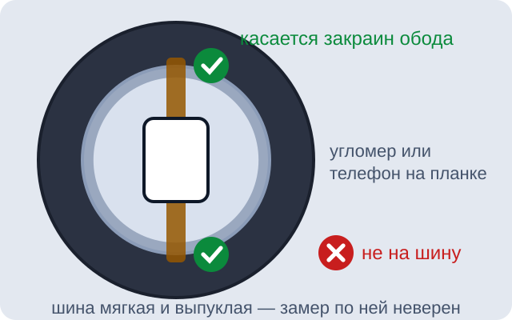 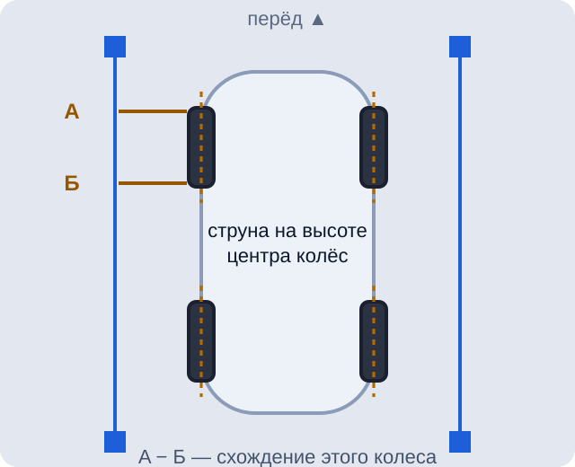 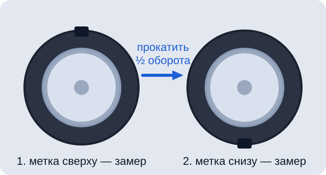

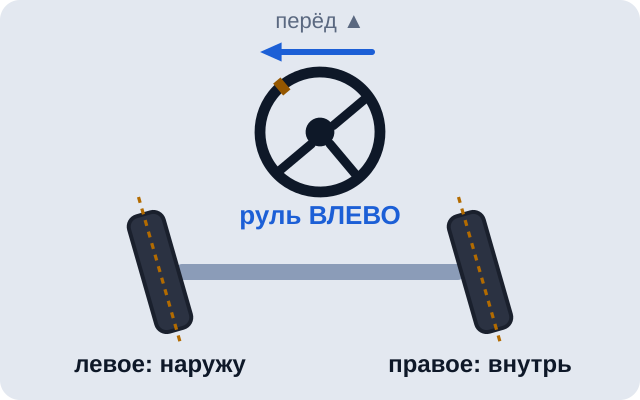 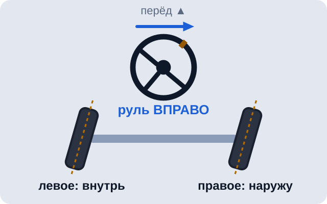

## Замер: телефон на колесе

1. Нажмите **«Телефон»** вверху справа — с любого экрана — и отсканируйте QR-код камерой телефона. Доступ по Wi-Fi включится сам. То же — на вкладке «Замер → Телефон на колесе». Телефон и компьютер должны быть в одной сети Wi-Fi (подойдёт точка доступа на самом телефоне).
2. Браузер телефона предупредит о сертификате — он создан этой программой, а не удостоверяющим центром. «Дополнительно» → «Перейти на сайт». Windows может спросить разрешение для брандмауэра — разрешите в частных сетях.
3. На телефоне нажмите на колесо — кнопки стоят там же, где колёса у машины, — и «Включить датчики». На iPhone Safari спросит доступ к датчикам движения — разрешите.
4. Наверху три вкладки — что меряем: **Развал**, **Кастер**, **Схождение**.
5. **Развал → «Подготовка телефона»**, один раз: **1. Калибровка телефона** — на столе экраном вверх, затем экраном вниз; так вычитается собственная ошибка акселерометра, у телефонов она бывает до 1–2°. **2. Калибровка крепления** — телефон на планке на ободе, затем вверх ногами на том же месте; так вычитается перекос из-за выступа камеры и чехла. **3. Биение диска** — по желанию: замер, прокатить машину на пол-оборота, снова замер. Сделанные шаги отмечаются ✓ и запоминаются.
6. Прижмите телефон к планке экраном наружу — развал идёт на экран регулировки в реальном времени. Метка «стабильно» означает, что можно записывать.
7. **Кастер** (только передние колёса): колёса на поворотных кругах, тормоз зажат упором, «Начать замер кастера». Телефон сам ведёт: прямо, затем «поверните руль влево» или «вправо» примерно на 20°, затем в другую сторону — угол поворота он меряет гироскопом.
8. **Схождение** — вкладка объясняет, почему телефон на ободе его не меряет, и одной кнопкой переводит телефон в режим камеры с мишенями.

Приложенный к ободу телефон схождение не меряет: схождение — это поворот колеса вокруг вертикали, а акселерометр чувствует только наклон, сила тяжести при таком повороте не меняется. Гироскоп поворот чувствует, но копит ошибку — за минуту больше, чем весь допуск на схождение. Поэтому схождение берите струной или камерой: тот же телефон, поставленный на штатив, работает камерой в живом режиме (раздел «Камера и мишени»). Два телефона на колёсах — два колеса сразу, четыре — все четыре. Телефон, подключённый по ошибке, отключается кнопкой «Отключить» в списке.

**Проверка точности** — четвёртый шаг «Подготовки телефона», по желанию. Телефон снова кладут на стол экраном вверх и вниз, затем прикладывают к планке вертикально и вверх ногами — но калибровка не меняется, а сверяется. «Ноль» показывает, насколько с калибровки ушёл ноль акселерометра (бывает на морозе и с годами), «крепление» — насколько сдвинулся телефон на планке (новый чехол, другая планка). Больше 0,1° — телефон подскажет, какой шаг калибровки повторить. Так проверяют и профессиональные угломеры: переворотом на 180° смещение нуля меняет знак, а сам угол — нет.

**Гироскоп старых телефонов.** Chrome на Android до 66-й версии отдавал скорость поворота в радианах, а не в градусах, — угол поворота колеса вышел бы в 57 раз меньше. Программа сама узнаёт это по перевороту телефона при калибровке (это всегда не меньше 180°) и пересчитывает. Если кастер вышел отрицательным, телефон предупредит: чаще всего это значит, что руль сначала повернули не в ту сторону.

**Один раз настроили — дальше само.** Программа помнит, что доступ включён: после перезапуска он включается снова, адрес и код остаются прежними, а телефон с открытой страницей подключается сам и помнит своё колесо и калибровку. Страницу можно добавить на главный экран телефона. Если код видел кто-то посторонний — «Сменить ключ»: все телефоны отключатся, и каждому нужно будет отсканировать новый код. Когда телефоны больше не нужны — «Выключить доступ по Wi-Fi».

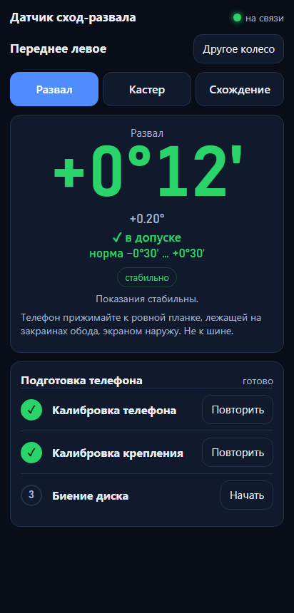

## Замер: камера и мишени

Печатная шахматная доска на жёстком листе крепится к колесу как угодно криво — программа находит ось вращения колеса по серии снимков, и перекос крепления уходит.

1. **Калибровка камеры** (один раз для каждой камеры и зума): 10–20 снимков шахматной доски под разными углами и во всех углах кадра. Размер клетки измерьте штангенциркулем по распечатке — принтеры масштабируют. Сохраните `camera.json`.
2. **Развал по фото:** вывешенное колесо, мишень на диске, камера строго по уровню сбоку. 4–6 снимков, проворачивая колесо на 10–20° между кадрами.
3. **Полный замер:** в каждый кадр вместе с мишенью на колесе должна попадать напольная мишень — она задаёт плоскость дороги и связывает четыре колеса в одну систему координат. Даёт развал, схождение каждого колеса и угол тяги. Мишеней на полу две (спереди и сзади), разного размера; их связывают снимки, где видны обе.

**Живой режим** (вкладка «4. Живой режим») — как на профессиональном 3D-стенде: телефон на штативе смотрит на колесо и мишень на полу, и развал со схождением меняются на экране регулировки 3–4 раза в секунду, пока вы крутите тягу. На телефоне — кнопка «Телефон как камера»:

1. **Печать мишеней** — на вкладке «4. Живой режим», кнопки «PDF: мишени колёс» и «PDF: напольные мишени». Печатайте в масштабе 100 % и проверьте линейку 100 мм внизу листа. Наклейте мишени на жёсткий ровный лист (фанера, ДСП, композит). На каждом колесе своя мишень разного размера — программа сама узнаёт, какое колесо видит, выбирать его на телефоне не нужно. Напольные мишени большие: их удобнее заказать одним листом в типографии.
2. **Калибровка камеры** — один раз для телефона: показывайте ему мишень с колеса под разными углами и в разных частях кадра, пока полоска не заполнится. Телефон держите горизонтально — и так же потом при замере.
3. **Биение** — для каждого колеса: вывесите его и медленно проверните рукой на четверть оборота и больше. Программа запоминает, как ось колеса стоит относительно мишени, и дальше ей хватает одного кадра.
4. **Замер** — машина на полу. Покажите камере по очереди все четыре колеса (и два-три кадра, где видны обе мишени на полу), после этого появится схождение. Дальше ставьте телефон у колеса, которое регулируете.
5. **Кастер камерой** — передние колёса на поворотных кругах, педаль тормоза зажата упором, чтобы колесо не проворачивалось. Режим «Кастер камерой» на телефоне, медленно поверните руль на 15–20° в одну сторону, затем в другую. Программа найдёт ось поворота колеса и покажет кастер и поперечный наклон оси.

Подробности, размеры мишеней и советы по съёмке — в файле OPTICAL.md в репозитории.

## Замер: свой датчик

Любое устройство в вашей сети — самодельная голова на ESP32, лазерный датчик, другая программа — может присылать углы программе обычным HTTP-запросом с JSON. Формат описан на вкладке «Замер → Свой датчик» и в файле SENSORS.md. Программа сама сглаживает показания, определяет, когда они успокоились, и показывает датчик в строке состояния сверху.

## Шаг 4. Экран регулировки

- **Цифры.** Зелёная — в допуске (**✓**), жёлтая — в допуске, но у границы (**!**), красная — вне допуска (**✕**), белая — допуск не задан, серая — показаний нет. Над цифрой — шкала допуска: зелёная зона, стрелка — текущее значение.
- **Виды.** F2 переключает общий вид и крупные виды передней и задней оси; F3 и F4 — сразу нужная ось. Для работы под машиной удобнее крупный вид: цифры видно с двух-трёх метров.
- **Единицы** — градусы с минутами, десятичные градусы; схождение можно показывать в миллиметрах (по диаметру обода с шага «Автомобиль»).
- **«Показания стабильны».** Пока значения меняются, внизу написано «показания меняются…». Записывать и затягивать контргайки — только когда стабильно.
- **Нажмите на любой угол** — справа откроется панель: что это за угол, чем он регулируется на вашей подвеске, что написано для этой модели.
- **Помощник «сколько крутить».** В той же панели: нажмите «Запомнить положение», поверните тягу или эксцентрик на известную величину (¼, ½, 1 оборот) и нажмите, на сколько повернули. Программа посчитает, сколько даёт один оборот на вашей машине, и дальше будет подсказывать: «до номинала ≈ 1¼ оборота, в ту же сторону».
- **«Что дальше»** — строка под итогом. Подсказывает следующий шаг: снимок «до», затем угол, который регулировать сейчас, в правильном порядке (задняя ось → кастер → развал → схождение), и сколько до допуска; потом снимок «после» и протокол. Кнопка справа делает это или открывает панель угла. Если угол на вашей подвеске не регулируется, строка так и скажет — ищите износ или деформацию.
- **Строка источников** вверху показывает, откуда идут данные: телефон, датчик, камера, ручной ввод, демо.
- **Звук и голос** — кнопки рядом с единицами, клавиши <kbd>F7</kbd> и <kbd>F8</kbd>: подсказки, когда экрана не видно (подробно — «Настройки и доступность»).

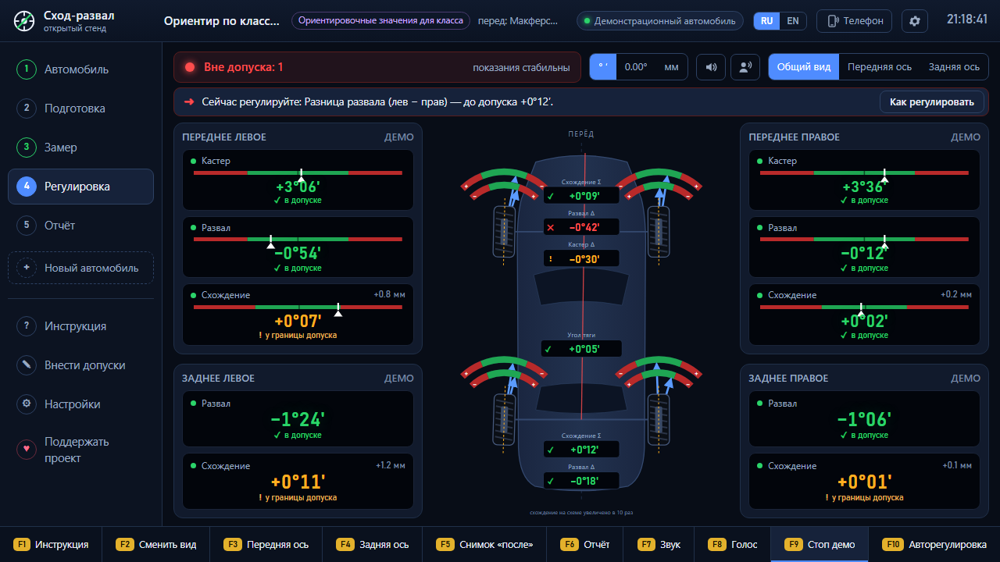

## Порядок регулировки — не переставляйте

1. **Задняя ось** (развал, потом схождение) — задаёт линию тяги, от которой отсчитывается переднее схождение.
2. **Кастер** — его изменение двигает и развал, и схождение.
3. **Развал** — двигает схождение.
4. **Схождение — последним.** Руль строго прямо и зафиксирован. Выставляйте схождение *каждого* колеса, а не только сумму: сумму можно набрать бесконечным числом способов, и лишь один оставляет руль прямым. Обе тяги крутите на одинаковую величину в противоположные стороны.
5. **Контрольный замер.** Затяните контргайки (затяжка часто сдвигает схождение), прокатите машину 3–5 м, покачайте кузов и перемерьте. Регулировка без контрольного замера — это не регулировка, а надежда.

**Куда крутить тягу, если не знаете:** четверть оборота — и смотрите на стрелку. Живой экран отвечает на этот вопрос быстрее любой схемы.

Этот же порядок — в заводских методиках: бюллетень Hyundai 20-SS-001H велит сначала выставить развал и схождение задних колёс, затем поставить руль прямо и зафиксировать его, и только потом регулировать передние кастер, развал и схождение; руководство Tesla — то же: задний развал, заднее схождение, передние развал и кастер, переднее схождение. Углы ставят в середину допуска, а не «чтобы вошло».

**Руль встал криво, хотя схождение в норме?** Значит, схождение поделено между колёсами неровно. Панель переднего схождения на экране регулировки подскажет, куда будет смотреть руль, — выставьте руль прямо и доведите каждое колесо до его номинала.

 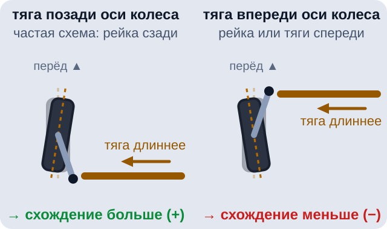

## Шаг 5. Отчёт

Протокол строится из двух снимков: «до» — перед регулировкой, «после» — когда всё выставлено. F5 на экране регулировки делает снимок в один нажим (сначала «до», затем «после»). Для снимка нужны развал и схождение всех четырёх колёс.

В протокол можно вписать госномер или VIN, пробег и имя. «Печать / PDF» открывает системный диалог печати — выберите «Сохранить как PDF», чтобы получить файл. В протоколе указан источник допусков, порядок регулировки и замечания (биение дисков, разница включённых углов и т. п.).

Закончили с машиной — **«Новый автомобиль»**: показания, снимки, отметки подготовки и поля протокола очистятся, и следующая машина начнётся с чистого листа.

## Износ шин подскажет

Прежде чем мерить, посмотрите и проведите ладонью по протектору передних и задних шин: износ часто сразу говорит, какой угол сбит или что изношено. Запишите, что увидели, — после регулировки будет с чем сравнить.

|   | Износ | О чём говорит |
|---|---|---|
| 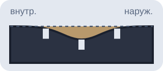 | **Середина** | Перекачана шина. |
| 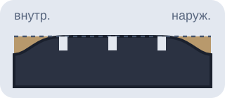 | **Оба края** | Шина недокачана. |
| 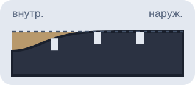 | **Внутренний край** | Отрицательный развал или расхождение; изношенные сайлентблоки, просевшие пружины. Самый частый износ. |
|  | **Наружный край** | Положительный развал или схождение; бывает и от резкой езды в поворотах. |
| 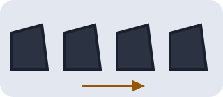 | **«Пила» — острые кромки шашек с одной стороны** | Схождение. Острая кромка с внутренней стороны шашек — избыточное схождение, с наружной — расхождение. |
|  | **Пятна по окружности** | Изношенные амортизаторы или стойки, люфты в подвеске, дисбаланс колеса. |

По справочнику MOOG «Understanding Tire Wear» и бюллетеню Hyundai 20-SS-001H. «Пилу» проще нащупать, чем увидеть: проведите ладонью поперёк протектора в одну и в другую сторону — с одной стороны кромки шашек острые. Пятна по окружности — не дело регулировки: сначала амортизаторы, балансировка и люфты.

## Диагностика: что погнуто

Развал и схождение регулируются, а поперечный наклон оси (SAI) и включённый угол (SAI + развал) заданы деталями. Если они не в норме или разные слева и справа, регулировка не поможет — что-то погнуто. Сравнивайте борта между собой.

| Развал | SAI | Включённый угол | Вероятная причина |
|---|---|---|---|
| не в норме | в норме | в норме | Кулак цел. Сбит регулировочный эксцентрик, сдвинут подрамник, погнут рычаг или смещена опора стойки. |
| не в норме | не в норме | в норме | Кулак цел. Погнута стойка, рычаг или смещена верхняя опора стойки. |
| не в норме | любой | не в норме | Погнут поворотный кулак (цапфа) — меняют кулак. |

По бюллетеню Hyundai 20-SS-001H: разница SAI слева и справа больше 1° — ищите повреждённые детали; SAI меньше на одной стороне — чаще погнут нижний рычаг, больше — повреждена верхняя опора стойки. SAI из замера с поворотом колеса неточен: ошибка нуля угломера 0,1° даёт почти 2° SAI, поэтому такой вывод подтверждайте камерой.

**Углы поворота колёс.** На поворотных кругах поверните руль так, чтобы наружное колесо стояло на 20°, и запишите угол внутреннего; затем в другую сторону («Замер → Углы поворота колёс»). Внутреннее колесо обычно поворачивается больше наружного, но главное — чтобы влево и вправо было одинаково: разница больше 1° — погнут поворотный рычаг кулака или рулевая тяга, даже если схождение в норме. Такую машину не регулируют, а чинят.

Таблица — по учебным материалам к экзамену ASE A4; точные значения SAI, включённого угла и углов поворота для вашей модели — в руководстве по ремонту.

## Контрольная поездка

Регулировку проверяют дорогой. Методика из бюллетеня Hyundai 20-SS-001H:

1. Прямой ровный участок не короче 250 м, без колеи, ветра и заметного уклона; полоса шириной 3–3,5 м.
2. Давление в шинах по норме, в машине только водитель.
3. Скорость около 64 км/ч (40 миль/ч). Поставьте руль так, чтобы машина шла прямо, и легко его отпустите.
4. Засеките, за сколько секунд машину уведёт на метр — от одного края полосы к другому. **Дольше 6 с — норма, 6 с и быстрее — уводит.**
5. Повторите в обратную сторону по той же дороге: если увод сменил сторону, виновата дорога или ветер, а не машина.
6. Если машина едет прямо, а руль стоит криво, — повторите регулировку схождения с зафиксированным прямо рулём.

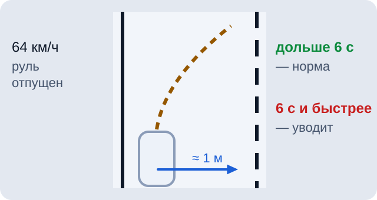

Итог поездки записывается в протокол — раздел «Контрольная поездка» внизу отчёта.

## Типы подвески

Заводские допуски у каждой модели свои, а конструкций подвески в мире около дюжины. Тип подвески определяет, что вообще можно отрегулировать, чем, и что нужно проверить до регулировки.

| Значение в программе | Подвеска | Ось |
|---|---|---|
| Макферсон | стойка, совмещённая с амортизатором | любая |
| Двухрычажная на шаровых опорах | два поперечных рычага, кулак на шаровых опорах | любая |
| Двухрычажная шкворневая | ГАЗ-21, 24, 3102, 3110: кулак на шкворне | передняя |
| Неразрезная балка на шкворнях | грузовики, автобусы, ГАЗель, УАЗ | передняя |
| Неразрезной мост на шаровых опорах | мост без шкворней | передняя |
| Многорычажная | несколько рычагов на колесо | любая |
| Полузависимая балка | балка, скручивающаяся между продольными рычагами | задняя |
| Мост на рессорах | неразрезной мост на листовых рессорах | задняя |
| Мост на пружинах и тягах | неразрезной мост, пружины или пневмобаллоны, реактивные тяги | задняя |
| Продольные рычаги | независимая на продольных рычагах | задняя |
| Косые рычаги | независимая на косых рычагах | задняя |

Для каждой конструкции программа показывает, как узнать её на своей машине, что обычно регулируется и чем, и что
проверить до регулировки: **F1 → «Типы подвески»**.

## Грузовики, автобусы, фургоны

- Передняя балка на шкворнях: **развал и поперечный наклон шкворня не регулируются** — отклонение означает погнутую балку, изношенные шкворни или подшипники.
- **Кастер** исправляют клиновыми прокладками между рессорой и площадкой балки — одинаковыми с обеих сторон.
- **Схождение** задаёт поперечная рулевая тяга — только суммарное. Руль «прямо» выставляют длиной продольной тяги (сошка — поворотный рычаг).
- Сдвоенные задние колёса считаются одним колесом — мерьте по наружному; давление в обеих шинах одинаковое.
- Схождение в руководствах грузовиков часто дано в мм по шине или по ободу — укажите в программе тот диаметр, к которому оно отнесено.
- Многоосные машины (задняя тележка) программа пока считает как двухосные: передняя ось и один задний мост. Параллельность мостов тележки проверяйте отдельно.

## Когда регулировка не поможет

- **Разный включённый угол** (поперечный наклон оси + развал) слева и справа, больше 1° — погнута стойка, кулак или рычаг. Развал и наклон оси по отдельности могут «врать», их сумма — нет.
- **Разная колёсная база** слева и справа (больше 10 мм) — деформация кузова, рамы или рычагов.
- **Большой сдвиг колёс** вдоль машины (больше 12 мм) — деформация подрамника или лонжерона.
- **Угол тяги** на неразрезном мосту или балке — регулировки нет: срезанный центральный болт рессоры, ослабшие стремянки, погнутая балка.
- **Развал «гуляет»** от замера к замеру — люфт шкворней, шаровых или сайлентблоков. Сначала ремонт.

## Откуда берутся допуски

Полные заводские базы допусков — платные коммерческие продукты, и выдумывать цифры нельзя: неверный развал — это съеденная за сезон резина и машина, которая плохо ведёт себя в экстренной ситуации. Поэтому у каждой записи в программе указан источник:

- `Заводское руководство` — сверено с документом, указаны издание и страница.
- `Сообщество` — перепроверено по независимому источнику.
- `Не проверено` — из одного источника, показывается с предупреждением.
- `Только конструкция` — известна подвеска, допусков нет; сравнение с ориентиром по классу.
- `Ориентир по классу` — типичные значения для конструкции, **не** для вашей модели.

У вас есть руководство по ремонту? Кнопка «Внести допуски» слева: программа проверит цифры на опечатки, запомнит их у вас и подготовит файл, который можно прислать в проект, — чтобы им пользовались все владельцы этой модели. Укажите издание и страницу: без источника запись не примут в общую базу.

## Если что-то не работает

| Что происходит | Что сделать |
|---|---|
| Окно не открывается, программа открылась в браузере | Не установлен Microsoft Edge WebView2 Runtime (бывает на старых Windows 10). Установите его с сайта Microsoft — или работайте в браузере, это та же программа. |
| Телефон не открывает адрес | Телефон и компьютер в одной сети? Гостевой Wi-Fi часто изолирует устройства — подключите оба к точке доступа телефона. В Windows сеть должна быть «Частной», а брандмауэр — разрешать программу в частных сетях. |
| «Подключение не защищено» на телефоне | Так и должно быть: сертификат создан программой. «Дополнительно» → «Перейти на сайт». |
| «Ссылка устарела» | Ключ в адресе сменили кнопкой «Сменить ключ». Отсканируйте новый QR-код. |
| Телефон пишет «нет связи с компьютером» | Программа на компьютере закрыта или телефон вышел из сети Wi-Fi. Как только программа снова запущена, а телефон в той же сети, связь вернётся сама — сканировать заново не нужно. Если у компьютера сменился адрес в сети, отсканируйте код ещё раз. |
| Датчики телефона не отвечают | Откройте страницу в Chrome (Android) или Safari (iPhone); на iPhone разрешите доступ к датчикам движения. Встроенные браузеры мессенджеров датчики не дают. |
| Цифры «прыгают» | Телефон не прижат к планке, планка опирается на резину, ветер качает струну, кто-то сидит в машине. Дождитесь «показания стабильны». |
| Калибровка камеры «плохая» | Больше снимков, доска во всех углах кадра и под наклоном, доска наклеена на жёсткий плоский лист, размер клетки измерен штангенциркулем. |
| Кастер вышел отрицательным | Чаще всего руль сначала повернули не в ту сторону. Для левого колеса — сначала влево, потом вправо; для правого — сначала вправо. Повторите замер кастера. |
| Проверка точности телефона не пройдена | «Ноль» — повторите калибровку телефона на столе (шаг 1), «крепление» — калибровку крепления на планке (шаг 2). Проверьте, что планка ровная и прижата к закраинам обода. |
| Нашли ошибку | Опишите её в Issues на GitHub и приложите `wheelalign.log` из папки данных. |

## Откуда методика

Порядок работы, проверки и пороги в программе взяты из открытых документов производителей и учебных материалов, а не придуманы:

- **Hyundai, бюллетень 20-SS-001H** «Wheel Alignment Requirements and Best Practices» (2020, опубликован NHTSA): порядок регулировки, увод от развала и кастера, разница развала 0,5°, разница SAI 1°, контрольная поездка.
- **Tesla, руководство Model 3**, «Four Wheel Alignment Check and Adjust»: подготовка, нагрузка, высота кузова, упор педали, фиксация руля, порядок «зад — перед», контрольная поездка.
- **MOOG (Federal-Mogul), «Understanding Tire Wear»**: износ шин и его причины.
- **Учебные материалы к экзамену ASE A4** (подвеска и рулевое управление): осмотр перед регулировкой, проверка люфтов, качание руля, диагностика по SAI и включённому углу, углы поворота колёс.
- **Analog Devices, AN-1057** «Using an Accelerometer for Inclination Sensing»: калибровка датчика наклона переворотом на 180° — на ней основаны калибровка и проверка телефона.
- **W3C, «Device Orientation and Motion»**, и изменение Chromium для Chrome 66: скорость поворота — в градусах в секунду; до Chrome 66 на Android — в радианах.

Заводские допуски вашей машины — только из её руководства по ремонту: см. «Откуда берутся допуски».

## Безопасность

- Под машину — только на надёжных подставках. Домкрат — подъёмное устройство, а не опора.
- Тормоза, рулевое и подвеска — узлы, от которых зависит жизнь. Не уверены в сборке — найдите того, кто уверен.
- После регулировки: первая поездка на малой скорости по пустой дороге. Руль стоит прямо, машину не уводит?
- Контргайки рулевых тяг затянуты, шплинты на месте.

## Клавиши

|   |   |
|---|---|
| <kbd>F1</kbd> | Инструкция |
| <kbd>F2</kbd>…<kbd>F6</kbd> | Автомобиль, подготовка, замер, регулировка, отчёт (на экране регулировки — свои) |
| <kbd>F12</kbd> | Следующий шаг |
| **На экране регулировки:** |  |
| <kbd>F2</kbd> | Сменить вид |
| <kbd>F3</kbd> / <kbd>F4</kbd> | Передняя / задняя ось крупно |
| <kbd>F5</kbd> | Снимок «до», затем «после» |
| <kbd>F6</kbd> | Отчёт |
| <kbd>F7</kbd> / <kbd>F8</kbd> | Звуковые сигналы / голос для выбранного угла |
| <kbd>F9</kbd> / <kbd>F10</kbd> | Демонстрация / авторегулировка: программа сама выставляет углы по шагам |
| <kbd>←</kbd> <kbd>→</kbd> | В демонстрации — «крутить» выбранный угол (с Shift — крупнее) |
| <kbd>Esc</kbd> | Закрыть боковую панель |
| **Везде:** |  |
| <kbd>Tab</kbd> / <kbd>Shift</kbd>+<kbd>Tab</kbd> | К следующему / предыдущему элементу |
| <kbd>Enter</kbd>, пробел | Нажать кнопку, открыть выбранный угол |

---

[Русский](#ru) · **English**

# Wheel alignment — guide

Wheel alignment is neither magic nor a workshop secret. It is four wheels, a few angles and the order in which to set them. Here is everything you need to do it yourself and do it right, from installing the program to the printed report.

The same guide is inside the program — press **F1**. Method and accuracy in depth — [PROCEDURE.md](PROCEDURE.md#eng).

**Contents:** [In short: five steps](#en-start) · [Installing and first start](#en-install) · [Settings and accessibility](#en-access) · [The angles in plain words](#en-angles) · [Step 1. Vehicle](#en-vehicle) · [Step 2. Preparation](#en-prep) · [Tools and floor](#en-tools) · [Measuring: strings and an inclinometer](#en-string) · [Measuring: a phone on the wheel](#en-phone) · [Measuring: camera and targets](#en-optical) · [Measuring: a sensor of your own](#en-sensor) · [Step 4. The adjustment screen](#en-live) · [Adjustment order — do not change it](#en-order) · [Step 5. The report](#en-report) · [What tyre wear tells you](#en-tyres) · [Diagnosis: what is bent](#en-diag) · [Road test](#en-road) · [Suspension types](#en-susp) · [Trucks, buses, vans](#en-trucks) · [When adjustment will not help](#en-bent) · [Where the specifications come from](#en-data) · [If something does not work](#en-trouble) · [Where the method comes from](#en-sources) · [Safety](#en-safety) · [Keys](#en-keys)

## In short: five steps

1. **Vehicle.** Find your car in the database or take the guidance for its class. Check the front and rear suspension type — the checks and the adjustment advice depend on it.
2. **Preparation.** A checklist for your suspension: pressures, play, load, floor. Adjusting a worn suspension is pointless — the angles will wander off at the first bump.
3. **Measurement.** Choose what to measure with: strings and an inclinometer, a phone, a camera or a sensor of your own. Methods can be combined — for example camber and caster by phone, toe by string.
4. **Adjustment.** A screen like an alignment bench: big figures, green when in spec, red when not; above each, a tolerance scale with a pointer. Tap an angle and a panel shows what adjusts it on your car. Before the first turn of a spanner, take the “before” snapshot (F5).
5. **Report.** When everything is green, take the “after” snapshot (F5) and open the report with its before/after table (F6). It can be printed or saved as PDF.

**Nothing gets lost.** The chosen vehicle, the figures you typed, the “before” and “after” snapshots, the checklist and the plate number are kept by the program: close it, open it tomorrow — everything is still there, and the screen opens where you stopped. Start the next car with **“New vehicle”** in the menu on the left (or in the report): everything of the previous one is cleared, while phone and camera calibrations stay.

**The “what next” line** on the adjustment screen leads you through the whole job: the “before” snapshot, then the angles in the right order, the “after” snapshot, the report. Its button does the next thing right away.

> New to this? Start the demonstration (F9 on the adjustment screen) and press F10 — the program shows by itself in which order and how the angles are set. With the ← → keys you can “turn” any angle yourself and watch what happens to the others.

## Installing and first start

1. **Download** `wheelalign.exe` from the project's releases page on GitHub. No installation is needed: it is a single file and can even live on a USB stick.
2. **Run it.** The program opens its own window, powered by WebView2, which is built into Windows 10 and 11. If the window cannot open, the program opens in your ordinary browser and tells you what to install.
3. **Language** — the RU / EN switch in the top right corner. On first start the system language is used; your choice is remembered.
4. **No internet needed.** Everything runs on this computer. Only the phone sensor needs a network, and a local one (Wi-Fi) at that, not the internet.

Where your data lives: `%APPDATA%\wheelalign` (on Linux `~/.config/wheelalign`). It holds the settings (`settings.json`), the current job — the vehicle on the stand, the figures typed in, the snapshots (`session.json`), your own specifications (the `vehicles` folder), phone calibrations (`phones.json`) and phone access (`phone-link.json`), the phone certificate (`tls`) and the log `wheelalign.log` — attach it when reporting a bug.

Start options: `-browser` — open in the browser instead of a window; `-data <folder>` — keep the data elsewhere (for example next to the program on a USB stick). Full list: `wheelalign -h`.

## Settings and accessibility

The program should suit everyone: whoever works in a bright garage, sees poorly or cannot tell colours apart, lies under the car alone or uses only a keyboard. All of it is in “Settings” (the ⚙ icon at the top right): it applies at once and is kept in the program's settings file.

- **Theme.** Dark — like an aligner's screen; light — for a bright garage and sunlight; high contrast — black and white, bright colours and thick borders.
- **Interface size** — normal, large, extra large: everything grows at once — text, buttons, figures.
- **Status colours.** If red and green are hard to tell apart, choose “Blue and orange”. A sign always stands next to the colour: **✓** — in tolerance, **!** — near the limit, **✕** — out of tolerance; the signs show on a black-and-white printout of the report too.
- **No animation** — for those bothered by blinking. By default the program follows the Windows “Show animations” setting.
- **Adjusting by ear.** Choose an angle on the adjustment screen and turn the sound on (<kbd>F7</kbd>): out of tolerance the program beeps — faster the closer it gets — a chime sounds on entering the tolerance and a low tone on leaving it. The voice (<kbd>F8</kbd>) reads the chosen angle aloud and says when it is in tolerance and when everything is. The voice is the system one, from Windows; if there is none for your language: Settings → Time & language → Speech → “Add voices”.
- **No mouse needed.** Everything works from the keyboard: <kbd>Tab</kbd> — to the next element, <kbd>Enter</kbd> or Space — press, <kbd>Esc</kbd> — close the panel; the F-keys are labelled at the bottom of the screen. A frame shows where the focus is. A screen reader (the one built into Windows, or NVDA) reads the readings, the result and the program's messages.
- **Workshop.** Its name, address and the person doing the job go into the report header.
- **The welcome** on first start walks through these settings and helps choose a way to measure. To open it again — “Settings → Show the welcome again”.

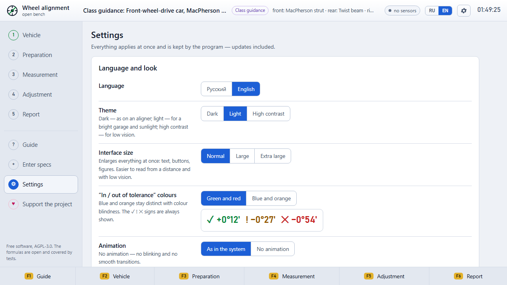

## The angles in plain words

| Angle | What it is | When it is off |
|---|---|---|
| **Camber** | Tilt of the wheel across the car, seen from the front. “Plus” — the top of the wheel leans out. | One edge of the tread wears (the outer one with positive, the inner with negative camber). A left–right difference above ~0.5° pulls the car towards the side with more camber. |
| **Toe** | Rotation of the wheel seen from above. “Plus” — the front edge of the wheel is closer to the car's centreline (toe-in). | The most expensive angle: it feathers a tyre in a few thousand kilometres. A crooked steering wheel when driving straight means the toe is split wrongly between the wheels. |
| **Caster** | Fore–aft tilt of the steering axis (the kingpin on kingpin axles). “Plus” — the top of the axis leans back. | Steering does not return to centre, the car wanders at speed. A left–right difference pulls towards the side with less caster. |
| **Steering axis inclination (SAI)** | Tilt of the steering axis across the car. Fixed by design. | Not adjustable. A left–right difference points to a bent strut, knuckle or axle beam. |
| **Included angle** | SAI + camber. | Differs left to right by more than 1° — a part is bent; camber adjustment will not cure it. |
| **Thrust angle** | Where the rear axle points relative to the car's centreline: half the difference of the rear wheels' toe. | The car “crabs”, the steering wheel is off-centre when driving straight although the front toe is in spec. |

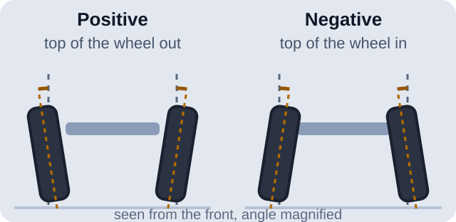 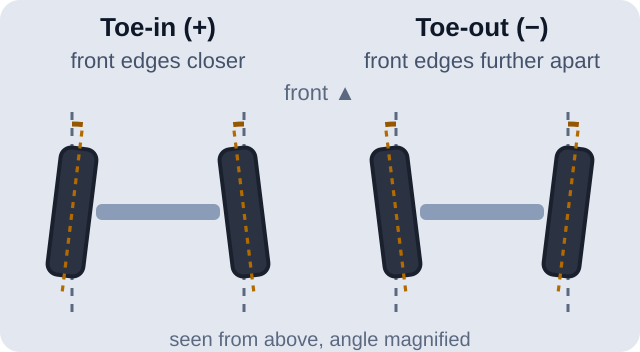 

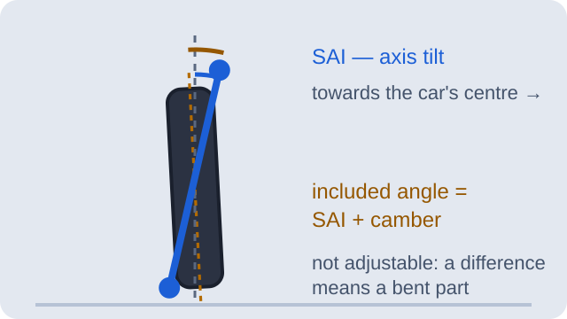 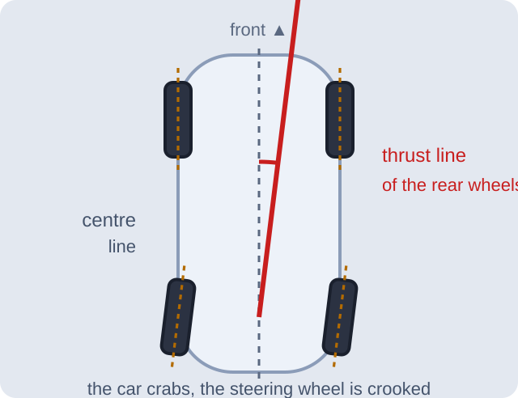

In short, what pulls a car (Hyundai bulletin 20-SS-001H): it pulls towards the wheel with more positive camber — the front camber difference should be under 0.5° — and towards the wheel with less caster. Toe does not cause a pull, but tyre wear and whether the steering wheel sits straight depend on it. Tyres (unequal pressure, ply steer and conicity), a dragging brake, a sagging spring, road crown and crosswind can pull a car too.

## Step 1. Vehicle

- **Search** by make and model, in Latin or Cyrillic letters: “Volga 3110”, “GAZelle”, “2107”, “Hilux”. The filters at the top narrow the list to cars, SUVs, vans, trucks or buses; the “Year” box drops other generations.
- **Not sure of the spelling?** While the search box is empty, every make is listed below by region (USSR and Russia, Europe, USA, Asia) with its number of models, along with recently chosen vehicles. Click a make to keep only its models.
- Every entry carries a **source badge**: factory manual, community, unverified, design only. The weaker the badge, the more carefully treat the figures — see “Where the specifications come from”.
- **Model not in the database?** Choose the guidance for its class (“car with MacPherson struts”, “truck with a kingpin beam axle”…). These are typical values for the design, not for your model: the program shows how far the angles are from typical and says so honestly on every screen.
- **Suspension.** The program fills in the suspension type from the database; if it is missing, choose it yourself. “How do I tell which one I have?” explains how to tell a kingpin from a ball joint, MacPherson from double wishbones.
- **Dimensions.** The rim diameter converts toe from degrees to millimetres (many manuals give it that way). The front and rear track widths are used to check the strings.
- **Your own specifications.** If you have a workshop manual, use “Enter specs from the manual”. The program checks the figures for typos and uses them on this computer.

You can also work without choosing a vehicle — the angles are then shown without an in-spec / out-of-spec verdict.

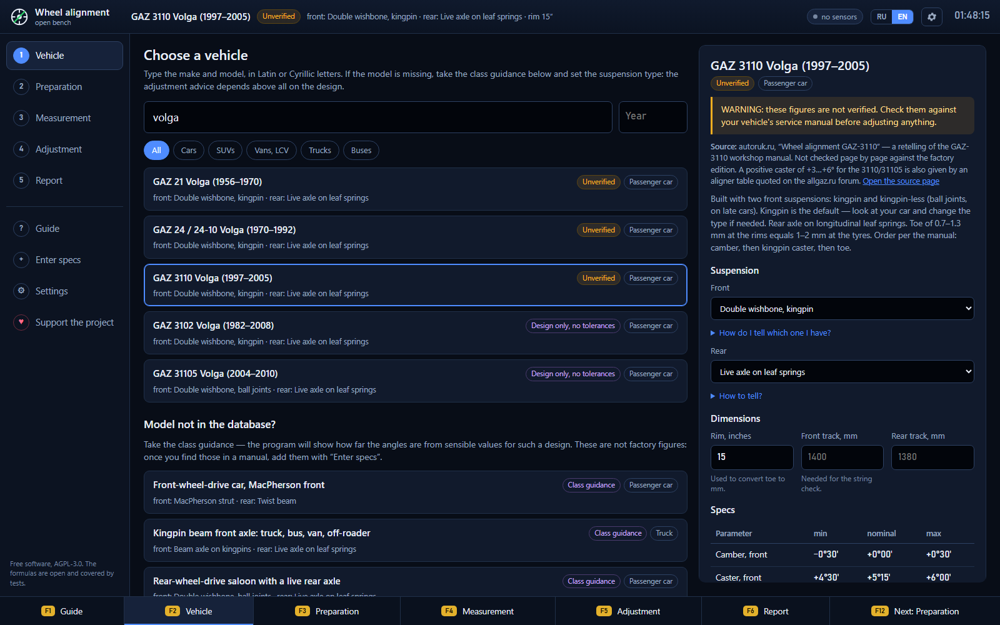

## Step 2. Preparation

Items with a picture have a **“What it looks like”** button — the diagram opens right under the item.

The checklist follows the chosen suspension: kingpin play for a beam axle, strut top bearings for MacPherson, U-bolts and the centre bolt for leaf springs. The items are grouped — safety, tools, floor, vehicle, front and rear suspension — and each group has its own counter. In large type: what to do; in small type: why. Tick items off as you go — the ticks are saved; once everything is ticked, “All done — ready to measure” appears.

The “Tools” group depends on the way of measuring: a line and an inclinometer for strings, a bar and a shared Wi-Fi network for a phone, targets and a tripod for a camera. You can choose the way right in this group — the “Measurement” step will already have it selected.

- **Tyre pressures** — as on the door-pillar placard, with cold tyres. A 0.3 bar left–right difference already changes camber.
- **Play** — tie-rod ends, ball joints or kingpins, wheel bearings, bushings. If a wheel rocks by hand, repair first.
- **Load** — as the manual requires: usually a full tank, spare wheel and tools in place, nobody inside. For trucks and buses — the stated axle load.
- **Steering straight.** Before measuring toe, set the steering wheel straight and lock it (a prop between wheel and seat).
- **Let the suspension settle.** After lifting the car, bounce the body and roll it 3–5 metres forward — the arms return to their working position. Do not roll it back or push it sideways: the bushings would stay loaded differently from how they are when driving.

## Tools and floor

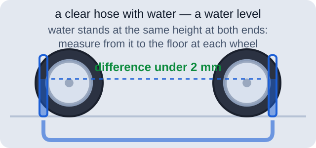 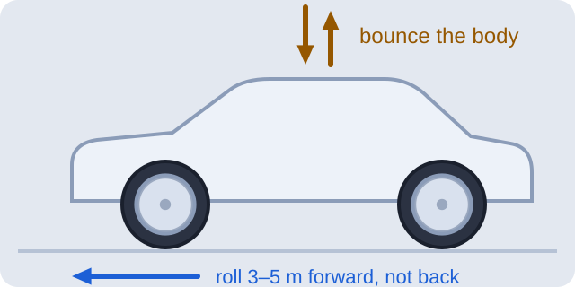 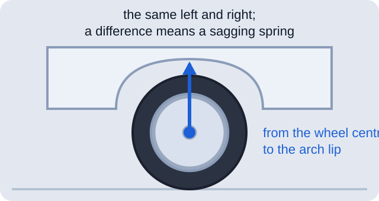

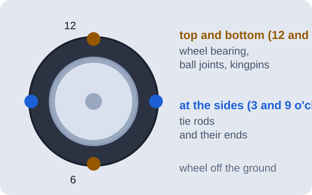 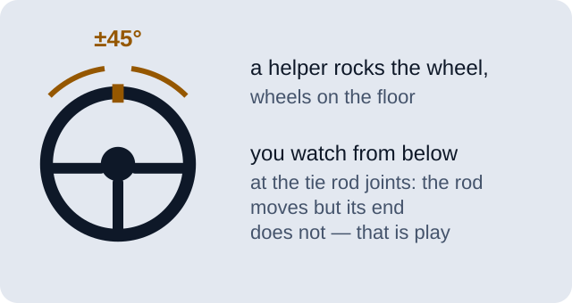

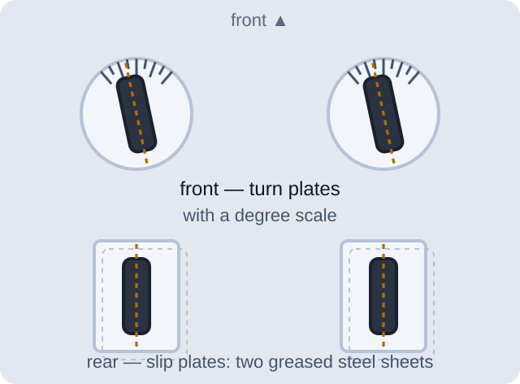 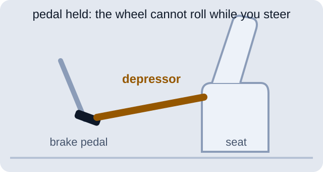 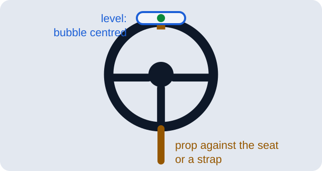

| What | What for | Substitute |
|---|---|---|
| Fishing line 0.3–0.5 mm, 2 × 5 m | Reference lines for toe | Not thread — it sags and stretches |
| 4 stands up to hub height | Hold the strings | Bricks with blocks, buckets of sand |
| Weights of 2–4 kg | Tension the strings without sag | Bottles of water |
| Tape measure, calipers or a rule | Distances to the rim | — |
| Inclinometer or smartphone | Camber | Spirit level with a protractor |
| Straight bar 40–50 cm | Holds the inclinometer or phone against the rim flanges | Aluminium straightedge |
| Turn plates | Caster | Two sheets of tin with grease between them |
| Axle stands | Safety | **Never a jack instead. Never.** |

**The floor matters most.** It need not be “level” but it must be *flat*: all four wheels in one plane. A 5 mm dip under one wheel on a 1400 mm track is 0.2° of camber error, half a factory tolerance. Check with a water level (a clear hose filled with water): the contact patches should differ by less than 2 mm. Shim with steel plates, not wood. Turn plates and the packing under the rear wheels must be the same height.

## Measuring: strings and an inclinometer

1. **Strings** run along both sides, outside the wheels, at hub-centre height, tensioned by weights. The distance from the string to the hub centre at the front and at the rear **need not be equal**: with different front and rear track widths the difference must be (rear track − front track) / 2. Enter the four distances in “String setup check” and the program tells you which end to move and by how much.
2. **Camber** — the inclinometer on a bar held against the rim flanges (not the tyre). “Plus” — the top of the wheel leans out. If your inclinometer reads the other way, tick the box. Then roll the car half a wheel turn (a chalk mark on the tyre) and measure the same spot of the rim again. The program averages the two readings and removes rim runout; runout above 0.5° means a bent rim and unreliable readings for that wheel.
3. **Toe** — from the string to the rim flange at the front and rear of the wheel, strictly at hub height. Higher or lower mixes camber into the reading. A wheel pointing inwards has the larger front distance; enter it as it is.
4. **Caster** — on turn plates: camber with the wheel steered 20° out and 20° in. “Out” for the left wheel is the steering wheel turned left, for the right wheel — turned right. The program solves this exactly, not with the “swing × 1.5” rule, which is off by up to 0.27° on cars with large caster. Read the steer angle off the turn plate scale or chalk it on the floor.

Every figure you enter goes straight to the adjustment screen and is kept. While working: turn the tie rod, measure, enter the new figure. The screen updates at once. Delete a figure and it leaves the screen too; “Clear all fields” removes everything typed by hand at once.

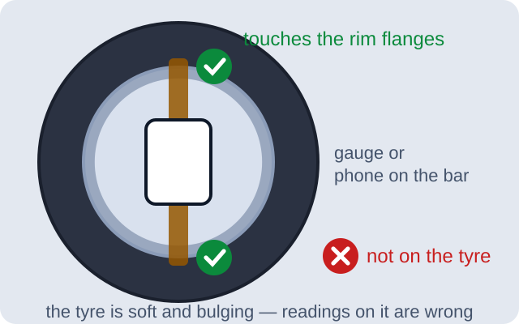 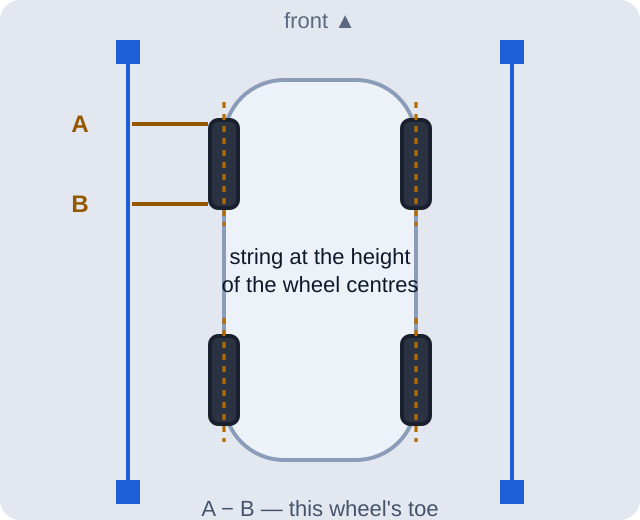 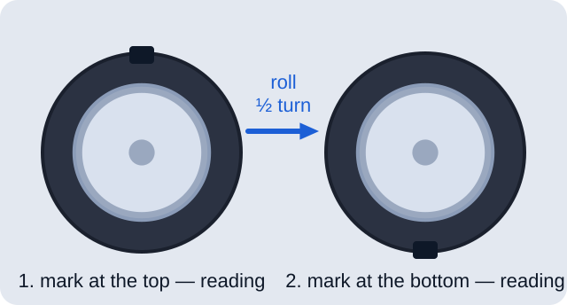

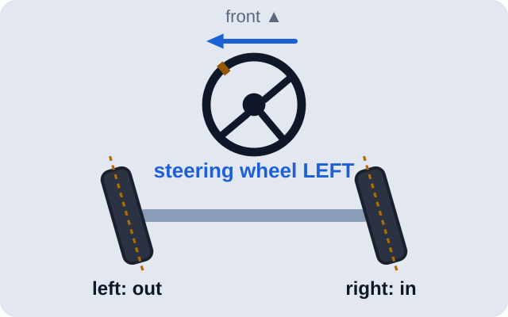 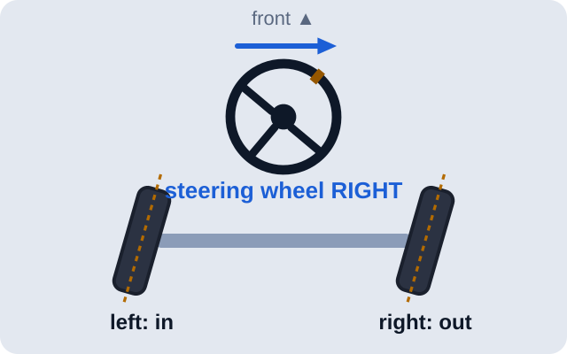

## Measuring: a phone on the wheel

1. Press **“Phone”** at the top right — from any screen — and scan the QR code with the phone's camera. Wi-Fi access switches on by itself. The same is on “Measurement → Phone on the wheel”. Phone and computer must be on the same Wi-Fi network (a hotspot on the phone itself will do).
2. The phone's browser warns about the certificate — it was made by this program, not by a certificate authority. “Advanced” → “Proceed to the site”. Windows may ask for firewall permission — allow private networks.
3. On the phone, tap the wheel — the buttons sit where the wheels are on the car — and press “Start sensors”. On an iPhone Safari asks for motion sensor access — allow it.
4. At the top there are three tabs — what you measure: **Camber**, **Caster**, **Toe**.
5. **Camber → “Preparing the phone”**, once: **1. Phone calibration** — on a table screen up, then screen down; this removes the accelerometer's own error, which on phones can reach 1–2°. **2. Mount calibration** — the phone on the bar on the rim, then upside down on the same spot; this removes the tilt caused by the camera bump and the case. **3. Rim runout** — optional: a reading, roll the car half a wheel turn, another reading. Finished steps get a ✓ and are remembered.
6. Press the phone against the bar, screen facing out — camber flows to the adjustment screen in real time. The “steady” tag means the reading can be trusted.
7. **Caster** (front wheels only): wheels on turn plates, brake held with a prop, “Measure caster”. The phone leads the way: straight, then “turn the steering wheel left” or “right” about 20°, then the other way — it measures the steer angle with its gyroscope.
8. **Toe** — the tab explains why a phone on the rim cannot measure it, and one button turns the phone into a camera with targets.

A phone held to the rim does not measure toe: toe is a rotation of the wheel about the vertical, and the accelerometer senses only tilt — gravity does not change under such a rotation. The gyroscope does sense it, but drifts — within a minute by more than the whole toe tolerance. So take toe by string or by camera: the same phone on a tripod works as a camera in live mode (see “Camera and targets”). Two phones on the wheels measure two wheels at once, four — all four. A phone connected by mistake is removed with “Disconnect” in the list.

**Accuracy check** — the fourth, optional step of “Preparing the phone”. The phone goes on the table screen up and down again, then on the bar upright and upside down — but the calibration is compared, not changed. “Zero” shows how far the accelerometer's zero has moved since calibration (it does in the cold and with age), “mount” — how far the phone has shifted on the bar (a new case, another bar). Over 0.1° and the phone tells you which calibration step to repeat. Professional inclinometers are checked the same way: turned over by 180°, the zero offset changes sign and the angle does not.

**The gyroscope of older phones.** Chrome on Android before version 66 gave the rotation rate in radians rather than degrees — the wheel's steer angle would come out 57 times too small. The program finds this out from the turn-over during calibration (always at least 180°) and converts. If caster comes out negative, the phone warns: most often the steering wheel was turned the wrong way first.

**Set up once — then it just works.** The program remembers that access is on: after a restart it switches on again, the address and the code stay the same, and a phone with the page open reconnects by itself, keeping its wheel and its calibration. You can add the page to the phone's home screen. If someone else has seen the code, press “New key”: every phone is disconnected and each has to scan the new code. When the phones are no longer needed, “Switch Wi-Fi access off”.

## Measuring: camera and targets

A printed chessboard on a rigid sheet can be fixed to the wheel as crookedly as you like — the program finds the wheel's axis of rotation from a series of photos, and the mounting error drops out.

1. **Camera calibration** (once per camera and zoom): 10–20 photos of a chessboard at different angles and in all corners of the frame. Measure the square size on the printout with calipers — printers scale. Save `camera.json`.
2. **Camber from photos:** wheel lifted, target on the rim, camera strictly level at the side. 4–6 photos, turning the wheel 10–20° between them.
3. **Full measurement:** every frame must show a floor target as well as the wheel target — it defines the road plane and ties the four wheels into one coordinate system. It gives camber, individual toe and the thrust angle. There are two floor targets (front and rear) of different sizes; photos showing both link them.

**Live mode** (tab “4. Live mode”) — as on a professional 3D aligner: a phone on a tripod watches the wheel and the floor target, and camber and toe update on the adjustment screen 3–4 times a second while you turn the tie rod. On the phone — the “Phone as a camera” button:

1. **Print the targets** — on the “4. Live mode” tab, the “PDF: wheel targets” and “PDF: floor targets” buttons. Print at 100 % scale and check the 100 mm ruler at the bottom of the sheet. Glue the targets to a rigid flat board (plywood, chipboard, composite). Each wheel has its own target of a different size — the program recognises which wheel it sees, there is no need to choose it on the phone. The floor targets are large: it is easier to order them as one sheet from a print shop.
2. **Camera calibration** — once per phone: show it the wheel target at different angles and in different parts of the frame until the bar fills. Hold the phone in landscape — and the same way later when measuring.
3. **Runout** — for each wheel: lift it and slowly turn it by hand a quarter turn or more. The program remembers how the wheel's axis sits relative to the target, and from then on a single frame is enough.
4. **Measure** — car on the floor. Show the camera all four wheels in turn (and two or three frames showing both floor targets), then toe appears. After that, put the phone by the wheel you are adjusting.
5. **Caster by camera** — front wheels on turn plates, the brake pedal held down with a prop so the wheel cannot roll. “Caster by camera” mode on the phone, slowly steer 15–20° one way, then the other. The program finds the wheel's steering axis and shows caster and steering axis inclination.

Details, target sizes and photography tips are in OPTICAL.md in the repository.

## Measuring: a sensor of your own

Any device on your network — a home-made ESP32 head, a laser sensor, another program — can send angles to the program as a plain HTTP request with JSON. The format is on “Measurement → Own sensor” and in SENSORS.md. The program smooths the readings, detects when they have settled and shows the sensor in the status bar at the top.

## Step 4. The adjustment screen

- **Figures.** Green — in spec (**✓**), amber — in spec but near the limit (**!**), red — out of spec (**✕**), white — no specification, grey — no reading. Above the figure is the tolerance scale: the green zone and a pointer at the current value.
- **Views.** F2 cycles between the overview and large front- and rear-axle views; F3 and F4 jump straight to an axle. Under the car the large view is easier: the figures are readable from two or three metres.
- **Units** — degrees and minutes or decimal degrees; toe can be shown in millimetres (at the rim diameter from the Vehicle step).
- **“Readings steady”.** While values are changing the screen says “readings changing…”. Record figures and tighten lock nuts only when steady.
- **Tap any angle** — a panel opens on the right: what the angle is, what adjusts it on your suspension, what the data says for this model.
- **The “how far to turn” helper.** In the same panel: press “Remember position”, turn the tie rod or eccentric by a known amount (¼, ½, 1 turn) and press how far you turned it. The program works out what one turn does on your car and from then on tells you: “to nominal ≈ 1¼ turns, the same way”.
- **“What next”** — the line under the verdict. It shows the next step: the “before” snapshot, then the angle to adjust now, in the right order (rear axle → caster → camber → toe), and how far it is from the spec; then the “after” snapshot and the report. The button on the right does it or opens the angle's panel. If the angle has no adjuster on your suspension, the line says so — look for wear or a bent part.
- **The source bar** at the top shows where data comes from: phone, sensor, camera, manual entry, demo.
- **Sound and voice** — the buttons next to the units, keys <kbd>F7</kbd> and <kbd>F8</kbd>: guidance when you cannot see the screen (see “Settings and accessibility”).

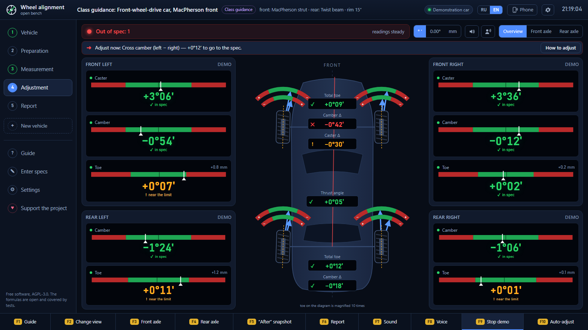

## Adjustment order — do not change it

1. **Rear axle** (camber, then toe) — it sets the thrust line from which front toe is measured.
2. **Caster** — changing it moves both camber and toe.
3. **Camber** — it moves toe.
4. **Toe — last.** Steering wheel dead straight and locked. Set the toe of *each* wheel, not just the total: the total can be reached in endless ways, and only one leaves the steering wheel straight. Turn both tie rods by the same amount in opposite directions.
5. **Check measurement.** Tighten the lock nuts (tightening often shifts toe), roll the car 3–5 m, bounce the body and measure again. An alignment without a check measurement is not an alignment, it is a hope.

**Which way to turn the tie rod if you don't know:** a quarter turn, then watch the pointer. The live screen answers that question faster than any diagram.

Factory procedures use the same order: Hyundai bulletin 20-SS-001H says to set rear camber and toe first, then centre and lock the steering wheel, and only then adjust front caster, camber and toe; the Tesla manual likewise goes rear camber, rear toe, front camber and caster, front toe. Set angles to the centre of the specification, not just “inside it”.

**Steering wheel crooked although toe is in spec?** Then the toe is split unevenly between the wheels. The front toe panel on the adjustment screen tells which way the steering wheel will point — set the steering wheel straight and bring each wheel to its own nominal.

 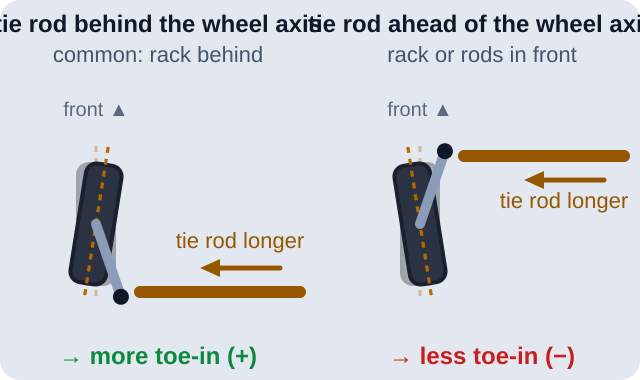

## Step 5. The report

The report is built from two snapshots: “before” — ahead of adjustment, and “after” — once everything is set. F5 on the adjustment screen takes a snapshot in one press (“before” first, then “after”). A snapshot needs camber and toe of all four wheels.

You can add the plate number or VIN, the mileage and your name. “Print / PDF” opens the system print dialog — choose “Save as PDF” to get a file. The report lists the source of the specifications, the adjustment order and remarks (rim runout, included-angle differences and so on).

Finished with the car — **“New vehicle”**: readings, snapshots, the checklist and the report fields are cleared, and the next car starts with a clean sheet.

## What tyre wear tells you

Before measuring, look at the front and rear tyres and run your palm over the tread: wear often tells at once which angle is off or what is worn. Write down what you see — after the alignment you will have something to compare with.

|   | Wear | What it tells |
|---|---|---|
| 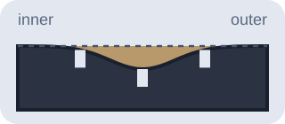 | **Centre** | The tyre is overinflated. |
|  | **Both edges** | The tyre is underinflated. |
|  | **Inner edge** | Negative camber or toe-out; worn bushings, sagging springs. The most common wear. |
|  | **Outer edge** | Positive camber or toe-in; also hard cornering. |
|  | **Feathering — tread blocks sharp on one side** | Toe. A sharp edge on the inside of the blocks means too much toe-in, on the outside — toe-out. |
|  | **Cupping around the tyre** | Worn shock absorbers or struts, play in the suspension, an unbalanced wheel. |

From MOOG's “Understanding Tire Wear” and Hyundai bulletin 20-SS-001H. Feathering is easier to feel than to see: run your palm across the tread one way and the other — on one side the block edges are sharp. Cupping is not an alignment matter: dampers, wheel balance and play come first.

## Diagnosis: what is bent

Camber and toe are adjusted, but steering axis inclination (SAI) and the included angle (SAI + camber) are set by the parts. If they are out of spec or differ left to right, adjustment will not help — something is bent. Compare the two sides with each other.

| Camber | SAI | Included angle | Probable cause |
|---|---|---|---|
| out of spec | in spec | in spec | The knuckle is sound. A misadjusted cam bolt, a shifted subframe, a bent control arm or a displaced strut tower. |
| out of spec | out of spec | in spec | The knuckle is sound. A bent strut, a bent control arm or a displaced upper strut mount. |
| out of spec | any | out of spec | A bent steering knuckle (spindle) — the knuckle is replaced. |

Per Hyundai bulletin 20-SS-001H: an SAI difference between left and right of more than 1° means damaged parts; lower SAI on one side often means a bent lower control arm, higher — a damaged upper strut mount. SAI from a wheel sweep is not precise: a 0.1° zero error of the gauge gives almost 2° of SAI, so confirm such a finding with the camera.

**Steering lock angles.** On turn plates, steer until the outer wheel stands at 20° and note the angle of the inner one; then the other way (“Measurement → Steering lock angles”). The inner wheel usually turns further than the outer, but what matters is that left and right match: a difference over 1° means a bent steering arm or tie rod, even when toe is in spec. Such a car is repaired, not adjusted.

The table follows study material for the ASE A4 exam; the exact SAI, included angle and lock angles for your model are in its workshop manual.

## Road test

An alignment is checked on the road. The procedure from Hyundai bulletin 20-SS-001H:

1. A straight, level stretch at least 250 m long, no ruts, wind or noticeable crown; a lane 3–3.5 m wide.
2. Tyre pressures to specification, only the driver in the car.
3. About 64 km/h (40 mph). Set the steering wheel so the car goes straight and let it go lightly.
4. Time how many seconds the car takes to drift one metre — from one side of the lane to the other. **More than 6 s passes, 6 s or less fails.**
5. Repeat in the opposite direction on the same road: if the drift changes side, the road or the wind is to blame, not the car.
6. If the car goes straight but the steering wheel is crooked, redo the toe with the steering wheel locked straight.

The result goes into the report — the “Road test” section at the bottom.

## Suspension types

Every model has its own factory specification, but there are only about a dozen suspension designs in the world. The design decides what can be adjusted at all, with what, and what to check before adjusting.

| In the program | Suspension | Axle |
|---|---|---|
| MacPherson strut | a strut combined with the damper | either |
| Double wishbone, ball joints | two transverse arms, knuckle on ball joints | either |
| Double wishbone, kingpin | GAZ-21, 24, 3102, 3110: knuckle on a kingpin | front |
| Rigid beam, kingpins | trucks, buses, GAZelle, UAZ | front |
| Rigid axle, ball joints | an axle without kingpins | front |
| Multi-link | several links per wheel | either |
| Twist beam | a beam twisting between trailing arms | rear |
| Live axle on leaf springs | rigid axle on leaf springs | rear |
| Live axle on coil springs and links | rigid axle, coil springs or air bags, reaction rods | rear |
| Trailing arms | independent, trailing arms | rear |
| Semi-trailing arms | independent, semi-trailing arms | rear |

For each design the program shows how to recognise it on your car, what is usually adjustable and with what, and what
to check before adjusting: **F1 → “Suspension types”**.

## Trucks, buses, vans

- Kingpin front beam axle: **camber and kingpin inclination are not adjustable** — a deviation means a bent beam, worn kingpins or bearings.
- **Caster** is corrected with taper shims between the leaf spring and the beam pad — the same on both sides.
- **Toe** is set by the cross tie rod — total toe only. The steering wheel is centred with the length of the drag link (pitman arm to steering arm).
- Twin rear wheels count as one wheel — measure the outer one; both tyres at the same pressure.
- Truck manuals often give toe in mm at the tyre or at the rim — enter the diameter the figure refers to.
- Multi-axle vehicles (rear bogie) are treated as two-axle for now: the front axle and one rear axle. Check the bogie axles for parallelism separately.

## When adjustment will not help

- **Different included angle** (steering axis inclination + camber) left to right by more than 1° — a bent strut, knuckle or arm. Camber and SAI may each “lie”, their sum does not.
- **Different wheelbase** left to right (more than 10 mm) — a deformed body, frame or arms.
- **Large setback** of the wheels along the car (more than 12 mm) — a deformed subframe or chassis rail.
- **Thrust angle** on a rigid axle or beam — there is no adjustment: a sheared spring centre bolt, loose U-bolts, a bent axle.
- **Camber wanders** from one reading to the next — play in kingpins, ball joints or bushings. Repair first.

## Where the specifications come from

Complete factory specification databases are paid commercial products, and figures must never be made up: a wrong camber means tyres eaten in one season and a car that behaves badly in an emergency. So every entry in the program names its source:

- `Factory manual` — checked against the document, edition and page given.
- `Community` — cross-checked against an independent source.
- `Unverified` — from a single source, shown with a warning.
- `Design only` — the suspension is known, the tolerances are not; compared with the class guidance.
- `Class guidance` — typical values for the design, **not** for your model.

Have a workshop manual? The “Enter specs” button on the left: the program checks the figures for typos, keeps them on your computer and prepares a file you can send to the project so that every owner of that model can use it. Give the edition and page: without a source an entry is not accepted into the shared database.

## If something does not work

| What happens | What to do |
|---|---|
| No window, the program opened in the browser | Microsoft Edge WebView2 Runtime is missing (happens on older Windows 10). Install it from Microsoft's site — or keep using the browser, it is the same program. |
| The phone cannot open the address | Are phone and computer on the same network? Guest Wi-Fi often isolates devices — connect both to the phone's hotspot. In Windows the network must be “Private” and the firewall must allow the program on private networks. |
| “Connection is not private” on the phone | That is expected: the certificate was made by the program. “Advanced” → “Proceed to the site”. |
| “Link expired” | The key in the address was changed with “New key”. Scan the new QR code. |
| The phone says “no connection to the computer” | The program on the computer is closed or the phone has left the Wi-Fi network. As soon as the program is running again and the phone is on the same network, the connection comes back by itself — no need to scan again. If the computer's network address has changed, scan the code once more. |
| The phone's sensors do not respond | Open the page in Chrome (Android) or Safari (iPhone); on an iPhone allow motion sensor access. Browsers built into messengers do not provide the sensors. |
| Figures jump around | The phone is not pressed to the bar, the bar rests on the tyre, wind shakes the string, someone is sitting in the car. Wait for “readings steady”. |
| Camera calibration is “poor” | More photos, the board in every corner of the frame and tilted, the board glued to a rigid flat sheet, the square size measured with calipers. |
| Caster came out negative | Most often the steering wheel was first turned the wrong way. For the left wheel — left first, then right; for the right wheel — right first. Measure caster again. |
| The phone's accuracy check failed | “Zero” — redo the phone calibration on the table (step 1); “mount” — the mount calibration on the bar (step 2). Check that the bar is straight and pressed against the rim flanges. |
| You found a bug | Describe it in Issues on GitHub and attach `wheelalign.log` from the data folder. |

## Where the method comes from

The working order, the checks and the thresholds in the program come from manufacturers' open documents and training material, not invention:

- **Hyundai, bulletin 20-SS-001H** “Wheel Alignment Requirements and Best Practices” (2020, published by NHTSA): the adjustment order, pull from camber and caster, the 0.5° camber difference, the 1° SAI difference, the road test.
- **Tesla, Model 3 service manual**, “Four Wheel Alignment Check and Adjust”: preparation, load, ride height, brake pedal depressor, steering wheel lock, rear-then-front order, road test.
- **MOOG (Federal-Mogul), “Understanding Tire Wear”**: tyre wear and its causes.
- **Study material for the ASE A4 exam** (suspension and steering): pre-alignment inspection, play checks, the dry park test, SAI and included angle diagnosis, steering lock angles.
- **Analog Devices, AN-1057** “Using an Accelerometer for Inclination Sensing”: calibrating a tilt sensor by turning it over by 180° — the phone's calibration and check rest on it.
- **W3C, “Device Orientation and Motion”**, and the Chromium change for Chrome 66: rotation rate in degrees per second; before Chrome 66 on Android — in radians.

Your car's factory tolerances come only from its workshop manual: see “Where the specifications come from”.

## Safety

- Get under a car only on sound axle stands. A jack is a lifting device, not a support.
- Brakes, steering and suspension are what lives depend on. Not sure about the assembly — find someone who is.
- After adjustment: the first drive at low speed on an empty road. Is the steering wheel straight, does the car pull?
- Tie-rod lock nuts tight, split pins in place.

## Keys

|   |   |
|---|---|
| <kbd>F1</kbd> | Guide |
| <kbd>F2</kbd>…<kbd>F6</kbd> | Vehicle, preparation, measurement, adjustment, report (the adjustment screen has its own) |
| <kbd>F12</kbd> | Next step |
| **On the adjustment screen:** |  |
| <kbd>F2</kbd> | Change view |
| <kbd>F3</kbd> / <kbd>F4</kbd> | Front / rear axle, large |
| <kbd>F5</kbd> | “Before” snapshot, then “after” |
| <kbd>F6</kbd> | Report |
| <kbd>F7</kbd> / <kbd>F8</kbd> | Sound signals / voice for the chosen angle |
| <kbd>F9</kbd> / <kbd>F10</kbd> | Demonstration / auto-adjust: the program sets the angles itself, step by step |
| <kbd>←</kbd> <kbd>→</kbd> | In the demonstration — “turn” the selected angle (with Shift — in bigger steps) |
| <kbd>Esc</kbd> | Close the side panel |
| **Everywhere:** |  |
| <kbd>Tab</kbd> / <kbd>Shift</kbd>+<kbd>Tab</kbd> | To the next / previous element |
| <kbd>Enter</kbd>, Space | Press a button, open the chosen angle |
